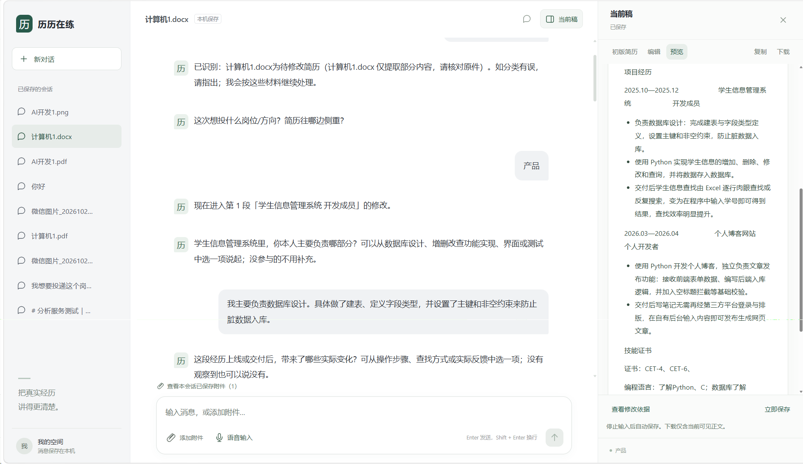

# 历历在练

面向实习求职场景的简历修改 Agent。用户提供简历、求职方向及可选岗位描述后，通过对话说明需要调整的内容；Agent 基于材料追问、提出有依据的改写，经用户明确确认后更新当前稿，支持预览、复制与 Markdown 下载。

本项目在本机运行。AI 分析需要自行配置 DeepSeek API Key；不开启模型时，可使用内容保存、预览和 Markdown 导出。语音输入可选用本地 Vosk 中文模型，转文字后校对并手动发送；语音输出尚未实现。

## 界面预览



通过对话补充经历、回答具体问题，并在右侧查看当前稿。输入区支持文字、附件和语音输入。

## 当前功能

| 功能 | 当前状态 |
|---|---|
| 对话式交互 | 支持创建、重开会话及恢复已保存消息与附件 |
| 多轮对话记忆 | 保存当前会话的问答、补充事实与处理进度，支持反馈调整和重开恢复；不承诺任意自然语言都能正确定位 |
| 整份简历检查 | 默认检查基本信息、教育、技能、项目／实习、自我评价／个人优势及奖项；可限定现有章节、跳过或再次调整 |
| 语音输入 | 浏览器录音后在本机转为文字，保留原有草稿，校对后手动发送；最长 60 秒，支持取消与失败重试；无语音输出 |
| 文字简历 | 支持直接粘贴到聊天；无稿件历史时识别候选文字，确认用途后原样建立初始稿并分析 |
| 文档与图片 | 支持 Markdown、DOCX、PDF、PNG／JPEG；DOCX／文字型 PDF 可提取文字，PNG／JPEG 可选用 `deepseek-flash` 转录，扫描页仍只本地预览 |
| AI 文本分析 | 配置模型并启用预算开关后，根据个人材料和岗位要求追问、提出改写 |
| 建议确认与依据 | 接受、拒绝或要求调整；检查目标、来源版本及用户答复范围，明确接受后才更新当前稿 |
| 当前稿 | 自动保存、版本冲突处理、编辑、安全预览、复制及 Markdown 下载 |
| 失败与恢复 | 保存失败保留输入；分析按已保存消息启动，支持停止、请求重放及迟到结果保护 |

自动分类每份材料最多读取 12000 字符；超出、未完整提取或多份简历无法确定用途时保留附件并询问，不截取后当完整简历导入。整体替换支持 Markdown，以及完整提取且无警告的 DOCX／文字型 PDF；图片转录结果暂不作为整体替换候选。

原始消息、待确认材料、改写建议与当前稿分别保存。上传成功不代表已识别，文字可读不代表用途已确认，生成建议也不等于已经修改正文。

## 技术结构

- 前端：TypeScript、React、Vite。
- 后端：Python、FastAPI、Uvicorn；业务接口与 Agent 在同一个后端服务中运行。
- 数据：SQLite 保存会话、原件、来源快照、稿件、建议、运行事件及项目费用记录。
- 模型：当前客户端默认使用 DeepSeek 文本模型；浏览器不持有模型密钥。
- 文档处理：DOCX／文字型 PDF 本地提取，PDF／图片本地转图与预览；PNG／JPEG 在聊天处理中可调用 `deepseek-flash` 转录（`VISION_ENABLED=1`，且确认项目预算），扫描型 PDF 未接入识别。
- 语音输入：Web Audio／AudioWorklet 采集声音并编码为 WAV；FastAPI 校验后由独立 Vosk 子进程离线识别，结果回填输入框，不自动发送。

## 本机启动

需要安装 Git、Node.js 24 和 Python 3.13。以下命令以 Windows PowerShell 为例；其他系统需调整虚拟环境的 Python 路径。依赖以 `frontend/package-lock.json` 与 `backend/requirements.txt` 为准。

先获取源码：

```powershell
git clone https://github.com/w7885/resume-rehearsal-agent.git
cd resume-rehearsal-agent
```

前后端分别在两个终端运行。下文“项目根目录”指克隆得到的 `resume-rehearsal-agent` 目录。

### 1. 基础后端：先检查保存与预览

首次准备环境，在项目根目录执行：

```powershell
cd backend
python -m venv .venv
.\.venv\Scripts\python.exe -m pip install -r requirements.txt
```

已有环境时直接在 `backend` 目录启动。以下模式关闭真实分析，不要求模型密钥：

```powershell
$env:AGENT_ENABLED = "0"
$env:AGENT_BUDGET_CONFIRMED = "0"
.\.venv\Scripts\python.exe -m uvicorn app.main:app --host 127.0.0.1 --port 3001 --workers 1
```

### 2. 前端

另开终端，从项目根目录执行：

```powershell
cd frontend
npm ci
npm run dev
```

前后端启动后，打开 [聊天页面](http://127.0.0.1:5173/)。

前端固定监听 `127.0.0.1:5173`，把 `/api` 代理到 `127.0.0.1:3001`；端口被占用时不会自动换端口。停止对应服务可在其终端按 Ctrl+C。修改后端代码或配置后，需要重启实际进程才能生效。

### 3. 可选：启用真实文本分析

调用模型会产生费用。启用前请确认所用 API Key 的可用额度；已有本机数据时，还需核对累计调用费用。停止原后端后，按以下方式启动。基础保存、预览和导出不要求开启模型。

在 `backend` 目录设置当前 PowerShell 的进程环境。密钥通过隐藏输入读取，不写入命令历史中的明文参数：

```powershell
$env:DEEPSEEK_API_KEY = [System.Net.NetworkCredential]::new("", (Read-Host "输入模型 API Key" -AsSecureString)).Password
$env:AGENT_ENABLED = "1"
$env:AGENT_BUDGET_CONFIRMED = "1"
$env:AGENT_PROJECT_LIMIT_CENTS = "3000"
$env:VISION_ENABLED = "1"
$env:VISION_MODEL = "deepseek-flash"
.\.venv\Scripts\python.exe -m uvicorn app.main:app --host 127.0.0.1 --port 3001 --workers 1
```

图片识别需要同时启用 `AGENT_ENABLED=1`、`AGENT_BUDGET_CONFIRMED=1` 和 `VISION_ENABLED=1` 并配置密钥；不需要图片识别时，将 `VISION_ENABLED` 设为 `0`。上传只保存原件，后续聊天分析才可能调用识别服务。图片与文本调用计入同一本机费用账本。

后端只读取进程环境变量。[配置样例](backend/.env.example) 用于查阅变量；仅复制为 `.env` 不会自动加载，也不会开启模型功能。

| 配置 | 作用 |
|---|---|
| `DEEPSEEK_API_KEY` | 后端模型凭证；真实值仅本地保存 |
| `AGENT_ENABLED=1` | 允许真实分析入口 |
| `AGENT_BUDGET_CONFIRMED=1` | 表示使用者已确认调用费用与本机累计预算 |
| `AGENT_PROJECT_LIMIT_CENTS` | 本机统一项目账本上限，单位分，最大 3000；不按会话或日期重置 |
| `VISION_ENABLED=1` | 允许识别已保存的 PNG／JPEG；须同时确认调用预算 |
| `VISION_MODEL` | 视觉模型 ID，当前预算费率仅支持 `deepseek-flash` |

开启后，处理所需的文字会发送至配置的模型提供商；启用图片识别时，还会发送所需图片。代码将本机累计调用预算限制在最高 30 元，可通过 `AGENT_PROJECT_LIMIT_CENTS` 设置更低上限。失败且费用未知的调用会保守计入，重启或删除会话不会清零。该账本仅统计经过本应用的调用，不能代替提供商账单，也不能汇总其他机器的费用。

## 使用流程

1. 打开聊天页，说明求职方向，粘贴简历或添加附件。岗位描述可选。
2. 可读附件先按正文自动区分简历、岗位描述与补充材料；内容或用途不明确时才询问。已有稿件时，明确要求用完整新版替换即可执行；仅上传另一份简历则先询问替换还是参考。仅供参考的他人简历不作为个人事实。聊天粘贴简历先定位正文起止行并确认用途；原始消息完整保留，范围外的指令不导入当前稿。
3. 只有一份有效 JD 时，默认按该 JD 确定目标并把岗位正文传入分析，不再重复问岗位；没有 JD 或目标不清时才询问。已明确提供的目标不会被自动覆盖。默认逐段检查整份简历，包括基本信息、教育、技能、项目／实习、自我评价／个人优势及奖项。原文清楚时直接整理或说明保留，信息不足才按该节追问；非经历段不强制回答职责和上线效果。基本信息的排版指当前 Markdown 的字段顺序、标题和列表整理。
4. 对唯一一条当前有效建议且答复对象唯一时，回复“是”“是的”“可以”等简短肯定词即可直接采用，无需再让模型猜测；多条候选、条件或引用表达仍需澄清，过期与范围校验保留。只有确认事务成功后，界面才会反馈当前稿已更新。
5. 采用成功后，Agent 自动检查指定范围内下一段，每回合最多提出一条新建议或一个具体追问；下一条仍须确认才写入。没有待确认建议时回复“继续”可接续；有待确认建议时，“继续”不会代替采用。回复“暂停”或“停止”可暂停，重开后保留已采用进度。原文已清楚时说明保留原因，全部处理后总结；预算不足或接续失败会区分已保存内容与未完成步骤。
6. 在右侧“当前稿”中，按“初版简历｜编辑｜预览”切换对比。初版只读，来自本轮首次导入记录；整体替换后以新版为本轮初版，没有可靠记录时显示暂无初版。初版视图可查看对应上传原件，复制／下载导出当前选中的版本；切换不会覆盖当前编辑内容。

可说“只修改自我评价”“只改基本信息”限定现有章节，或“检查整份简历”恢复整份检查；“第几个项目”的编号仍只计算项目，不会把教育或基本信息算进去。回复“跳过这一节”可明确保留本节原文后接续；若有一条有效待确认建议，会先记录拒绝该建议，不自动采用。个人优势可根据本人其他材料或回答提炼，语言润色不得虚构学历、证书或提高技能熟练度，新增内容仍需有原始依据并经用户确认。

左侧会话列表的“⋯”菜单可删除单个会话，确认后删除消息、已保存附件和当前稿，无法恢复。删除当前会话后回到新对话；删除其他会话不会清空当前输入。发送、保存或分析中先完成或停止任务；会话版本变化时须再次确认。项目累计模型费用不随会话删除而清零。

消息已保存与分析已完成是不同状态。分析中断后原话仍可恢复；相同已保存回合的请求重放只返回既有处理记录，需要继续分析时发送新的用户回合。尚未发送的输入与待上传文件不保证在强制刷新或关闭后恢复。

## 文件与功能边界

- Markdown、DOCX、文字型 PDF 可作为文字材料；提取结果可能部分成功或存在遗漏，支持查看与修正原文。
- PNG／JPEG 可以保存、下载与预览；启用图片识别后，由 `deepseek-flash` 转录为文字并分类。已保存的待识别图片可发送“识别图片”继续处理，不必重传；每轮最多处理 2 张，失败需明确发送“重试识别图片”才再次调用并可能产生费用。识别失败或关闭开关时，可粘贴文字或上传文字型文件。扫描型 PDF 仍只有预览，逐页识别未接入。
- 聊天文字的首次接入检查最近 6 条当前简历代次用户消息，单条上限为 20000 字符；正文起止须匹配唯一完整原文行，含糊或正文中夹指令时先要求分开发送。按明确栏目／项目边界无损分段，不通过模型重写导入正文。较长内容优先以文件上传，不截断导入。
- `.doc` 需另存为 `.docx`。损坏、加密、超限或不可读取的材料会返回提示，不静默当作完整解析成功。
- 明确指定项目序号（如“只优化第二个项目”）或可唯一匹配的完整项目名时，后端限制建议及接受操作的目标，并核对简历引用属于该项目的原文范围。后续明确切换项目可更新范围；无法定位或历史整稿未分段时先澄清，不静默重排旧稿。
- 交付格式为 Markdown，不包含 Word／PDF 导出、原版式还原或模拟面试。
- 当前为本机开发运行方式；未提供公网部署、账号系统或真实用户效果验证。
- 事实校验不能覆盖所有语义错误，仍可能遗漏无依据的资格证、能力或其他表述。采用建议前请核对原文、数字、职责和资质；能够打开引用不代表整句话均有依据。

## 可选：本地中文语音输入

语音输入先转成输入框中的文字，保留原有草稿，校对后手动发送；不会自动发送语音或消息。单次最长 60 秒，可取消，转写失败可重试。录音仅在浏览器及本机后端内存中处理，不写入会话或音频文件；手动发送后的文字沿用普通聊天保存规则。

在 `backend` 目录安装可选依赖和中文模型（首次安装需要联网下载，后续识别离线运行）：

```powershell
.\.venv\Scripts\python.exe -m pip install -r requirements-voice.txt
.\.venv\Scripts\python.exe scripts/setup_voice_model.py
```

重启后端，通过 `/api/voice/status` 核对 `available=true`。配置由进程环境变量读取：`VOICE_INPUT_ENABLED=0` 可关闭；`VOICE_MODEL_PATH` 默认 `.local/voice-models/vosk-model-small-cn-0.22`，相对路径从 backend 起算。模型及下载文件保持在被忽略的 `.local/`，不提交 Git。使用本机 localhost 页面，点击麦克风后授权，再点击“停止并转文字”。未授权或未配置时可继续键盘输入。

当前使用 Vosk 中文小模型，支持普通话输入，不包含语音回复。专有名词、同音字和标点可能识别不准，发送前需要校对；不代表真实麦克风或不同口音的效果已验收。

录音使用单声道、16000Hz、16 位 PCM WAV，接口上限为 **2 MiB（2,097,152 字节）**；60 秒音频约为 1.92MB。识别期间可以取消；切换会话会丢弃旧转写回执，避免文字进入另一会话。首次模型安装后如出现读取权限错误，应核对模型目录的继承权限；Windows 项目内默认采用相对路径加载，减少中文绝对路径兼容问题。

## 检查与测试

### 服务状态

- [后端健康检查](http://127.0.0.1:3001/api/health)
- [前端代理健康检查](http://127.0.0.1:5173/api/health)
- [FastAPI 接口页面](http://127.0.0.1:3001/docs)

`health=ok` 只表示服务可达；`model_configured=true` 只表示读到非空密钥，不能证明凭证有效、提供商已响应或稿件已保存。具体接口、字段与错误见 [业务 API 说明](backend/API.md)。

### 自动化检查

在 `backend` 目录执行，使用隔离测试数据，不调用真实提供商：

```powershell
.\.venv\Scripts\python.exe -m unittest discover -s tests -q
```

在 `frontend` 目录执行：

```powershell
npm test
npm run build
```

截至 2026-10-26，本地后端 **445 项**、前端 **58 项**测试及构建通过，覆盖材料接入、记忆与反馈、分节处理、自然收尾和语音边界。后端测试使用隔离数据与模拟模型响应，不调用付费提供商。程序测试通过不等于模型在不同岗位上的改写质量已达标。

语音页面测试使用合成中文音频、模拟麦克风和真实本地识别模型，验证文字回填、原有草稿保留且不自动发送；已检查桌面及 375px 页面。真实麦克风、不同口音、噪声和设备下的识别效果仍需实际试用。已有文本及图片模型样例联调不代表普遍的改写质量或 OCR 准确率。

## 数据保存与迁移

默认数据库为 `backend/.local/resume-agent.sqlite`，按源码位置确定。后端启动时自动初始化或迁移，保留原件、来源与正文快照；遇到不支持的结构或损坏数据库时会报错，不自动删除重建。升级已有数据前，请先停止后端并备份数据库。

在 `backend` 目录可手动执行：

```powershell
# 首次建立或升级结构；再次执行保留数据
.\.venv\Scripts\python.exe -m app.db init

# 只读检查，不创建缺失文件或自动修复
.\.venv\Scripts\python.exe -m app.db check
```

| 数据类别 | 主要内容 |
|---|---|
| 会话与材料 | 消息、附件原件、图页缓存、提取／识别结果 |
| 来源与稿件 | 不可变来源版本、当前及历史正文、确切引用 |
| 建议与决定 | 改写建议、用户答复关联、决定消费与事务结果 |
| Agent 运行 | 运行代次、分析请求、持久事件与上下文记忆 |
| 项目费用 | 调用预留、已结算及未知费用，独立于会话删除保留 |

同会话的引用与写入受范围、版本和有效来源校验；数据库只能保证结构与关联，不能证明用户经历真实或模型表达忠实。工具权限和写稿规则以代码及 [API 说明](backend/API.md) 为准。

## 隐私与本地文件

会话、附件、稿件和费用记录保存在本机数据库中。开启模型分析后，所需文字或图片会发送至所配置的模型提供商；可选语音识别在本机完成。

`.env`、默认数据库、运行日志、下载的语音模型和其他 `.local/` 内容由 `.gitignore` 排除。忽略规则不能识别任意文件中的密钥或个人信息；请勿将包含个人简历或密钥的文件提交到公开仓库，反馈问题时请先移除个人信息。接口字段与错误说明见 [业务 API 文档](backend/API.md)。
