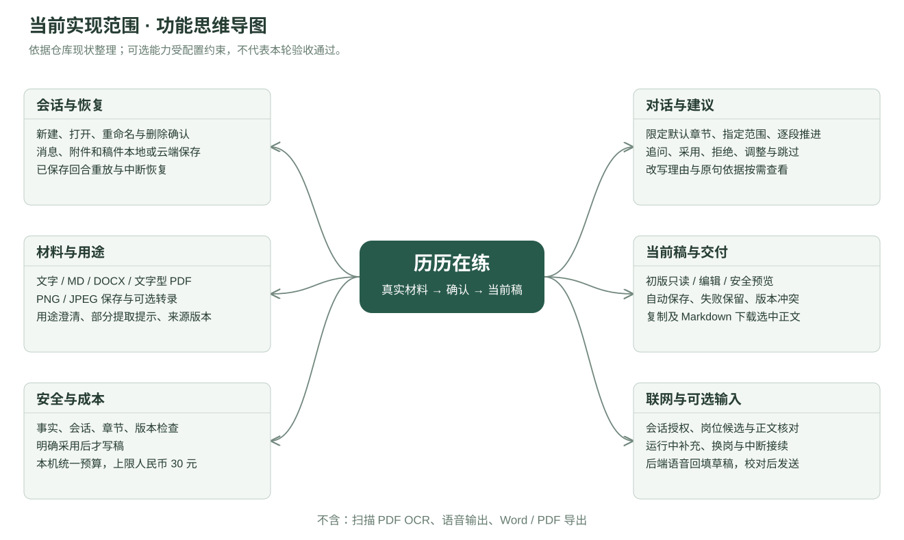
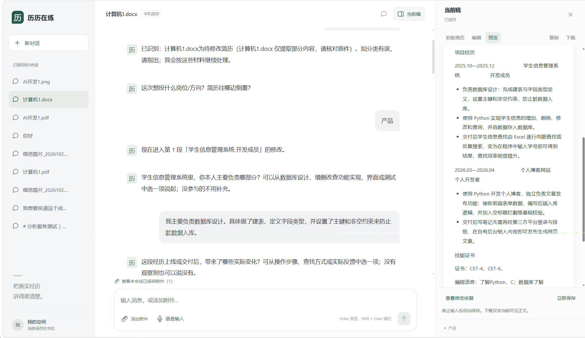
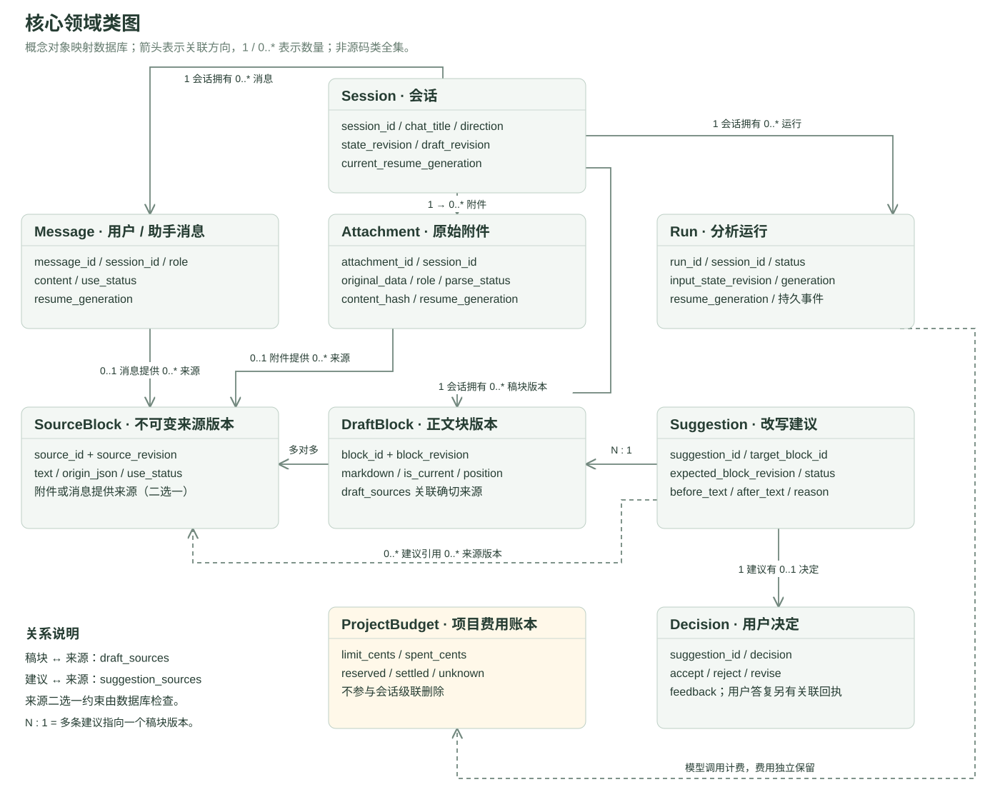
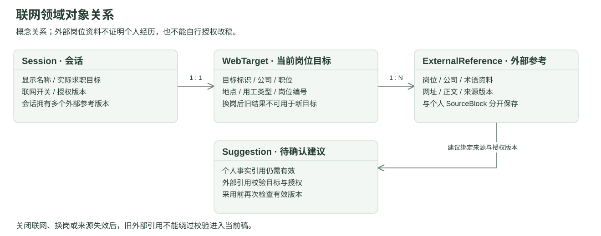

# 历历在练——软件需求规格说明书

| 项目 | 内容 |
| --- | --- |
| 项目名称 | 历历在练——面向大学生实习与毕业求职的简历修改 Agent |
| 文档编号 | LLL-SRS-001 |
| 文档状态 | 当前项目需求基线，待评审 |
| 更新日期 | 2026-11-08 |
| 适用范围 | 本地与云端简历修改、账号及数据保存需求；上线后的实际配置和验收以运行版本为准 |

项目标志沿用界面中的绿色底白色“历”字及“历历在练”名称。文档编号用于识别本文件。

本次文档依据本地 `fix-agent-route-blocking` 分支提交 `b3cafb6`、项目状态及问题日志整理。项目状态记录 PR #31 已合并，合并提交 `b93c696` 已部署并完成健康检查；本地功能分支和线上合并提交并非同一提交。线上业务效果须针对实际运行版本另行验收。

## 项目迭代记录

仅记录项目功能、优化与修复。现有记录未统一使用产品版本号，因此按日期和迭代事项登记；文档排版、措辞或目录调整不计为项目迭代。

| 日期 | 迭代事项 | 主要变化 | 状态与依据 |
| --- | --- | --- | --- |
| 2026-10-23 | 统一聊天入口与粘贴简历接入 | 以连续对话作为主要入口，按确认范围接入粘贴的简历 | 已合入；提交 `25e1c6f`、`743bdc2` |
| 2026-10-24 | 材料处理与交付闭环 | 增加有预算约束的材料接入、限定范围修改、采用后接续、会话删除和初版对比 | 已合入；提交 `e290512`、`4bf2dfd`、`dc64a35` |
| 2026-10-25 | 材料提取与问答接续优化 | 补充 DOCX 文本框提取，改进经历分段问答、上下文与修改引导 | 已合入；提交 `61c337b`、`12a5983`、`9f4f059` |
| 2026-10-26 | 整份检查与语音输入 | 支持更多现有章节的检查、本地语音输入，并改进材料利用与依据处理 | 已合入；提交 `bfd0f17`、`034d795` |
| 2026-10-27 | 原文快照与技能排版修复 | 固定改写依据，处理技能等级在双栏、断行等情况下的误判，保留原材料与有效补充 | 已纳入当前分支；相关保护已有开发回归，真实改写质量仍待固定样例验证 |
| 2026-10-27 | 对话意图与推进控制优化 | 区分回答、澄清、纠正等输入，避免未回答却推进问题状态 | 后续已集成；见 10 月 28—30 日记录 |
| 2026-10-28—30 | 对话控制与检查范围调整 | 集成对话事实保护与意图分流；区分澄清和回答；收窄默认检查章节；每个新段落独立播报 | 已集成；PR #20、#21，提交 `b1cf432`、`08b2c72`、`563868d` |
| 2026-11-01 | 会话显示名称修改 | 支持修改标题，保留实际求职目标和材料 | 已提交至当前分支；`7da6b3f` |
| 2026-11-01—04 | 受控联网与中断接续 | 增加会话联网授权、岗位查询与候选核对、同岗补充和换岗控制；修复取消失败与重开恢复，调整来源链接展示及回答接续 | 历史提交 `4fc5a4e`、`1ac0926`，相关集成已合并；已有隔离开发验证，完整真实效果与独立验收待完成 |
| 2026-11-06 | 解析、引导与联网失败提示优化 | 改进简历版式处理和提示，区分搜索失败与未找到候选 | PR #24、#25 已合并；真实效果及独立验收以对应记录为准 |
| 2026-11-06—07 | 云端数据库与账号访问 | 适配 PostgreSQL、账号归属与认证访问，接入邮箱注册、验证及密码重置；保留本地 SQLite 路径 | PR #26、#28 已合并；注册登录、重登恢复及双账号列表隔离基本路径获用户确认，跨账号直接访问等场景仍待验收；见 IMP-008（内部留存材料，未随本稿公开）、IMP-010（内部留存材料，未随本稿公开） |
| 2026-11-07 | 分析结果恢复与云端语音 | 改进断线后的已存结果读取和远程保存提示，配置服务端语音转写 | PR #27、#29 已合并；云端短句录音、文字回填且不自动发送获用户确认；复杂口音、并发及慢读恢复待验证 |
| 2026-11-07—08 | 分析连接与路由阻塞优化 | 增加分析流保活与脱敏耗时记录，将路由准备中的同步读取移出事件循环 | PR #30、#31 已合并；状态记录 `b93c696` 已部署、健康检查通过，真实文件处理与结果读回仍待浏览器复验；见 BUG-010（内部留存材料，未随本稿公开） |

记录依据为 Git 历史及项目状态。已提交、已合入或开发自测通过不等于产品验收通过；当前分支提交也不代表已合入主分支或完成部署。

## 目录

- [1 引言](#intro)
- [2 总体描述](#overall)
- [3 具体需求](#requirements)
- [4 验收标准](#acceptance)

## 1 引言

### 1.1 编写目的

说明历历在练的用户、功能范围、关键规则及验收方法，供项目成员和课程验收人员使用。本文根据现有项目补写，未将功能设想或未执行的测试写成已完成成果。

### 1.2 项目范围

本项目帮助寻找实习的大学生及毕业后寻找正式工作的大学生，根据真实简历、求职方向和可选岗位描述，通过对话补充经历、查看并确认修改建议，最终取得 Markdown 简历；有多年工作经验者不是主要目标人群。

当前范围包括材料输入、对话诊断、建议确认、依据查看、正文编辑、Markdown 导出、会话保存与恢复、会话重命名，以及按配置启用的联网岗位参考、图片识别和语音输入。云端模式包含账号注册、验证、登录和密码重置。

当前不包括扫描 PDF 的文字识别、语音输出、Word／PDF 简历导出、原版式还原、模拟面试和跨会话记忆。云端已保存数据可按账号恢复，但不将这一能力等同于已完成全面跨设备同步验证。系统不提供经历真实性认证，也不承诺录用率提升。

### 1.3 术语说明

| 术语 | 含义 |
| --- | --- |
| JD | 岗位描述，用于确定修改侧重，不作为个人经历证据 |
| Agent | 根据材料与对话选择追问或修改建议的程序 |
| 当前稿 | 已导入、经用户确认采用或由用户直接编辑的正式正文 |
| 初版 | 本轮首次可靠导入的简历正文，供只读查看和对比 |
| 个人来源 | 建议引用的原材料或用户补充原句，包含对应版本；用于核对个人事实 |
| 外部参考 | 联网取得的岗位、公司或术语资料，带目标和版本，只能辅助判断岗位侧重，不能证明个人经历 |
| FR／AC | 功能需求／验收用例编号，用于关联功能与验收 |

### 1.4 参考资料

- [GB/T 9385—2008《计算机软件需求规格说明规范》](https://openstd.samr.gov.cn/bzgk/std/newGbInfo?hcno=2790825C43AD0B69E3C38C140BFFCFE6)：参照其目录及附录 A.5“按照系统特征组织的 SRS 第 3 章模板”。前轮已阅读[全文 PDF 转载件](https://github.com/freeEasyUse/books/blob/master/GB-T%209385-2008%20%E8%AE%A1%E7%AE%97%E6%9C%BA%E8%BD%AF%E4%BB%B6%E9%9C%80%E6%B1%82%E8%A7%84%E6%A0%BC%E8%AF%B4%E6%98%8E%E8%A7%84%E8%8C%83.pdf)，本稿按项目及课程需要取舍，不作逐条符合性声明。
- 课程提供的需求分析文档要求：包含迭代记录、项目标志、思维导图、类图、功能描述和验收标准。
- [项目说明](../README.md)、[业务接口说明](../backend/API.md)及现有代码；开发进度另见项目状态（内部留存材料，未随本稿公开）。
- 联网接续开发验收记录（内部留存材料，未随本稿公开）：包含先前失败及后续复验，需结合顶部修复复验阅读。说明材料中个别早期状态尚未同步，本文以当前源码和后续记录核对结果为准。

### 1.5 文档概述

第 2 章说明产品和使用条件；第 3 章参照所选提纲描述接口、功能与约束，并纳入类图；第 4 章按作业要求给出验收标准。思维导图位于 2.2，项目标志和迭代记录位于文首。

## 2 总体描述

### 2.1 产品描述

历历在练是一个支持本地运行和云端访问的 Web 应用。学生上传或粘贴简历后，系统结合求职方向及可选 JD，逐段追问或提出改写，用户确认后更新当前稿。

核心路径：**输入简历与目标 → 必要澄清 → 提出建议并展示依据 → 用户确认 → 更新当前稿 → 预览与导出。**

AI 用于理解开放式经历和组织表达；程序负责保存、来源与版本检查、写入确认及预算控制。原文、建议和当前稿分别保存，生成建议不代表已经改稿。

产品关注两个问题：一是用户的经历材料零散，难以直接形成清晰的简历表述；二是改写容易脱离本人事实，用户难以判断修改依据。系统以逐段沟通和可查看依据的建议帮助处理这些问题；是否真正减轻校对负担，仍需通过试用验证。

**典型使用场景：**学生已有一份简历，希望针对某实习方向修改。用户上传简历并提供目标或 JD，系统识别可用内容；原文清楚时提出建议，信息不足时聚焦追问。用户核对并采用后，在当前稿查看结果，也可手改或提前导出，不必补齐所有经历才结束。

| 环节 | 用户行为 | 系统反馈与完成结果 |
| --- | --- | --- |
| 建立任务 | 新建会话并发送简历、方向及可选 JD | 先保存消息／原件；缺少目标或用途不清时询问，不将临时标题当作岗位 |
| 理解材料 | 查看解析状态，回答必要的用途或内容问题 | 区分可用、部分可用、未识别与失败；建立合法初版，不把操作指令写入简历 |
| 沟通修改 | 指定段落、补充事实、提出疑问或纠正 | 结合有效材料选择下一步；逐次追问或提出建议，不默认把所有消息都当经历回答 |
| 决定采用 | 查看改写和依据，接受、拒绝或要求调整 | 接受并校验成功才更新当前稿；其他情况保持正文或生成待确认新版 |
| 检查交付 | 查看初版／当前稿，手工编辑并复制或下载 | 展示保存状态；导出内容与选中正文一致，未保存内容有标记 |
| 中断与重开 | 暂停处理、离开后打开历史 | 恢复已保存消息、材料和稿件；不自动重做已采用修改 |

### 2.2 产品功能与思维导图

主要功能分为会话与恢复、材料与用途、对话与建议、当前稿与交付、安全与成本、联网与可选输入；云端账号注册、登录及归属检查详见 3.2.11。具体行为见 3.2。

### 2.3 用户特点

主要用户为寻找实习的大学生和毕业后寻找正式工作的大学生，能够使用浏览器、上传材料并核对个人事实，无需理解模型调用或数据库操作。界面以中文对话和按需查看依据为主。

需求依据包括项目讨论、试用反馈、工程记录和 93 份问卷：其中 41 人有简历准备经历，23 人本次用于实习或校招／其他正式求职；这 23 人中，分别有 14 人选择经历整理、写清个人行动和对照岗位决定重点费精力。该题多选，样本为便利招募且不能严格识别应届毕业生，只提供需求线索，不能推算总体用户规模或证明产品效果。详见选题与功能分析（内部留存材料，未随本稿公开）。

| 角色 | 可进行的操作 | 操作边界 |
| --- | --- | --- |
| 使用者 | 输入材料、回答问题、查看依据、决定建议、编辑与导出、管理会话 | 负责核对个人事实；删除须明确确认；云端访问须使用本人账号 |
| Agent／业务程序 | 读取有效材料、判断与追问、提出建议、校验及执行用户决定 | 不得自行采用建议，不得跨会话读取经历或绕过版本、来源和预算限制 |

模型与程序是系统能力，不是额外的登录账号或管理员角色。

### 2.4 约束

本地模式面向可信本机使用者；云端模式使用账号身份和数据归属检查。模型不能自行接受建议或跨会话读取个人材料。账号隔离须覆盖直接资源访问，不能只凭列表不可见认定全部安全场景通过。

本地模式使用 SQLite 保存数据；云端模式的已保存材料、对话和稿件由服务端持久化至 PostgreSQL，并按账号归属访问。开启模型分析时，所需文字或图片会发送至配置的模型服务；密钥留在后端。语音在所连接的后端使用 Vosk 转写，本地模式在本机处理，云端模式向服务端发送音频，不调用外部付费语音模型。联网另需当前会话授权；搜索仅发送必要岗位字段或用户提供的岗位链接，不将整份个人简历作为搜索词。

### 2.5 假设与依赖

- 使用者有权处理所提交的材料，并负责核对个人经历与改写事实。
- 所选环境的前后端服务、数据库和存储空间可用；云端访问另需账号认证与网络连接，启动方式见项目说明。
- AI 分析需要有效模型配置、网络及预算许可；不可用时仍可手工编辑和导出。
- 图片识别需要视觉配置；语音输入需要浏览器麦克风权限和所连接后端已配置的 Vosk 中文模型。
- 联网查询需要服务端启用、有效搜索／网页读取服务配置、预算许可及当前会话授权；外部网页可能失效、缺少正文或无法核实招聘状态。

### 2.6 需求分配

| 阶段／类别 | 范围与状态 |
| --- | --- |
| 当前基线 | 简历输入、对话修改、用户确认、Markdown 交付、会话恢复及云端账号访问；按准确验收版本验证 |
| 条件能力 | 联网岗位参考、图片转录与语音输入，配置满足时验收成功路径，否则验收提示和降级路径 |
| 后续课程交付 | 云端部署已有记录；真实文件处理、跨账号直接访问、模型和联网效果等场景按实际情况继续验收 |

## 3 具体需求

### 3.1 外部接口需求

#### 3.1.1 用户界面

截图用于说明早期已有布局；账号、重命名、联网和接续入口以当前界面及以下说明为准，不将历史截图当作最新完整界面或验收结果。

| 界面区域 | 入口与主要内容 | 操作与反馈 |
| --- | --- | --- |
| 云端账号入口 | 远程模式下提供邮箱注册、验证、登录和找回密码入口 | 成功登录后进入本人工作台；失败或验证未完成时提示处理方式 |
| 左侧会话列表 | 主页面常驻，展示已有会话 | 新建、打开、重命名与确认删除；删除当前会话后返回新对话，删除其他会话不清空当前输入 |
| 中间聊天区 | 新会话或打开历史后进入，展示消息、附件和建议 | 发送文字或附件、回答问题、决定建议、停止处理；显示阶段、候选选择和已保存消息的接续入口 |
| 材料与依据查看区 | 点击附件或相应建议的依据入口 | 查看原件、提取状态或引用原句；关闭后返回聊天，保留尚未发送的文字 |
| 联网控制 | 聊天区联网开关与岗位核对消息 | 默认关闭；按会话授权、选择候选和确认来源；合法岗位／来源链接可点击打开 |
| 右侧当前稿 | 通过“当前稿”入口展开，提供初版／编辑／预览 | 显示保存状态、复制或下载选中正文；初版只读，无可靠记录时显示暂无初版 |

空会话应提供文字与附件入口，不要求先填写独立的大表单。默认编辑当前稿；切换视图不覆盖未保存的编辑。保存失败、分析失败和材料不可读须给出相应提示，不能只显示笼统“成功”。

**页面组织与进入、退出：**首页 `/` 与 `/chat` 使用同一聊天页面，通过会话标识打开对应历史。没有会话时展示输入入口和空稿提示；首条有效输入保存后建立会话。已有会话在左侧选中，聊天标题、消息、附件与当前稿均对应同一会话。材料查看区、依据查看区及当前稿为页面内展开区域，关闭后回到原对话；重命名、删除使用弹窗，取消不执行新的修改。旧版模拟历史标记为只读，不与个人材料会话混用。

**主要交互及状态：**以下说明前端应显示的行为；输入上限和业务条件由后端再次校验，不能只依赖按钮禁用。

| 区域／操作 | 可操作条件与交互 | 成功、失败与恢复反馈 |
| --- | --- | --- |
| 读取与切换会话 | 选择历史或重新读取；加载、发送、未决操作及稿件保存期间限制会话操作；切换前先处理当前稿保存 | 加载时显示读取提示；失败说明原因，不把未读取到的数据显示为空白成功；未保存稿件不得被切换静默丢弃 |
| 消息输入与发送 | 文字或附件至少一项有效；Enter 发送，Shift + Enter 换行，中文输入法选词不触发发送；可移除尚未关联的附件 | 保存期间显示状态并防止重复提交；失败保留输入和附件进度。消息未确认保存时重试原发送，已保存时读回会话或重试分析，不重复发原话 |
| 处理进度与停止 | 运行中显示当前阶段及停止入口；允许的联网补充、排队与接续见 FR-016 | 不将“正在处理”当作完成；停止后保留已存结果，结果未知时显示核对／重试入口，不伪称提供商未收费 |
| 回复与修改确认 | 对待回答询问可选择“回复这条询问”并取消关联；对建议用明确答复接受、拒绝或要求调整 | 回显回复对象；生成建议不直接改稿。采用成功后刷新对应正文和状态；含糊、过期或保存失败时说明原因，不先显示已更新 |
| 附件与依据查看 | 点击消息附件或附件列表打开原件／文本；点击依据入口查看对应原句与修改记录 | 区分待处理、部分可用、失败和历史内容；关闭查看区保留聊天输入。来源不可读时提示，不用助手总结代替原句 |
| 当前稿编辑与保存 | 默认编辑；可切只读初版、编辑、预览，提供立即保存；可编辑且无阻塞时停止输入后自动保存 | 显示已保存、未保存、保存中、保存失败或版本冲突。失败保留文字并可重试；冲突展示服务器稿，用户选择保留本地文字并保存或采用服务器稿 |
| 复制与下载 | 有会话时按所选视图导出可见正文；没有可靠初版时禁用该初版的导出 | 提示复制／下载结果；未保存稿件保留未保存提示和文件名标记。剪贴板不可用时可选中文字或下载；导出不替代保存 |
| 重命名与删除弹窗 | 重命名回填现名并校验，未改变名称或输入非法时不能保存；删除展示对象和不可恢复说明，必须确认 | 请求期间防止重复操作；重命名未知结果沿原请求核对。删除失败保留会话，版本变化重新确认；取消不等于撤回已完成的保存 |
| 联网开关与候选 | 设置读取／保存、结果未知或后端不支持时限制再次切换；新会话可先选择，发送时保存；候选选择后再核对正文 | 保存时仍以上次已确认状态为准；错误提供原切换重试或重读设置。运行中可按规则关闭，授权变更不自动采用建议 |
| 语音输入 | 配置可用且无冲突操作时录音；等待授权、录音、转写分别显示；可取消或按提示重试 | 转写追加到最新草稿，不自动发送；拒绝权限、服务不可用或转写失败保留原文字，切会话不接收旧回执 |

**通用反馈：**没有历史、没有当前稿、没有可靠初版和正在读取是不同状态，分别说明原因及可进行的操作。前端校验服务返回的数据格式；网络超时或返回不完整时按“结果未确认”处理，保留本地输入。窄窗口下可展开会话列表、收起当前稿；尚未完成全设备适配验证，不将布局可收起表述为全面移动端兼容。

#### 3.1.2 硬件接口

不依赖专用硬件。键盘、鼠标和显示器用于常规操作；可选麦克风由浏览器授权和采集，设备或权限不可用时允许继续键盘输入。

#### 3.1.3 软件接口

| 软件／服务 | 用途与边界 |
| --- | --- |
| 浏览器 | 交互、文件选择、预览、复制、下载及可选录音 |
| 模型服务 | 根据允许发送的材料进行文本分析或图片转录；结果须校验和人工确认 |
| 搜索／网页读取服务 | 获取岗位、公司及术语参考；仅在会话授权及预算允许时调用，不接收整份个人简历作为搜索词 |
| SQLite／PostgreSQL | 本地模式使用 SQLite，云端模式使用 PostgreSQL，保存会话、材料、来源、正文、建议及费用记录 |
| 解析与语音组件 | 在所连接后端提取支持格式的文字；可选 Vosk 将录音转成待发送文字 |
| 身份认证服务 | 云端模式处理邮箱注册、验证、登录及密码重置；后端核验身份并检查数据归属 |

#### 3.1.4 通信接口

浏览器连接本地或远程后端，云端模式需提供已登录身份；普通业务使用 JSON，分析进度使用事件流。后端按配置通过 HTTPS 调用模型及搜索／网页读取服务，服务端密钥不下发浏览器。文件和语音按对应格式传输，输入上限见 3.3。接口失败应说明失败环节，不得把未保存或未完成分析显示为成功。

**核心接口契约：**下表列出当前主要交互接口，`{id}` 表示当前会话标识；不是新增功能或完整接口手册。普通变更请求使用 `requestId` 区分操作，并按接口携带预期版本。字段及格式以当前接口定义为准，不要求需求文档重复全部实现字段。

| 用途与主要接口 | 前端提交／读取 | 后端检查及返回 | 页面结果 |
| --- | --- | --- | --- |
| 会话创建与恢复：`POST /api/chat/sessions`；`GET /api/sessions`；`GET /api/sessions/{id}/conversation` | 创建请求标识或指定会话 | 返回会话、原始消息、材料、当前稿、可靠初版、可用能力及适用的待分析标记 | 更新列表与当前会话；已有内容恢复，未启用的分析能力有说明 |
| 保存聊天：`POST /api/sessions/{id}/chat/messages` | 原话、附件标识、请求标识、预期会话版本及可选回复对象 | 校验附件和回复归属、版本与重复请求；保存原话和关联，返回消息及新状态；此步骤不表示已分析或采用 | 回显已保存消息，按返回消息标识启动分析 |
| 附件处理：`POST /api/sessions/{id}/materials`；对应材料的 `GET` 与 `/file` | 原始文件字节及名称／请求参数，或支持的粘贴文本 JSON | 校验大小、类型和版本，保存原件并返回提取状态；查看返回材料和来源，下载返回原文件 | 展示原件已存、解析结果与用途状态；仅上传不覆盖当前稿 |
| 分析：`POST /api/sessions/{id}/runs` | 已保存的 `userMessageId`、请求标识及预期会话版本 | 读取服务器原话，校验可用能力、预算与运行状态，以 SSE 返回持久化进度及结果标识 | 显示阶段，读取已保存回复／稿件；不把临时进度直接当正式正文 |
| 运行恢复／停止：`GET /api/sessions/{id}/agent-requests/{requestId}`；`POST /api/runs/{runId}/cancel` | 原分析请求或运行标识 | 返回原请求记录／事件，或停止结果；拒绝旧运行迟到写入 | 读回、停止或提示继续；查询原请求不触发新模型调用 |
| 正文与建议：`PUT /api/sessions/{id}/draft`；`POST /api/sessions/{id}/suggestions/{suggestionId}/decision` | 手改全文，或决定、反馈及预期稿块版本；均携带请求和会话版本 | 手改校验后保存；决定再查目标、来源与版本，事务更新状态及适用正文 | 更新保存状态和正文；冲突保留本地稿。聊天中的明确采用也由后端执行同等业务校验 |
| 来源回查：`GET /api/sessions/{id}/sources/{sourceId}/revisions/{revision}` | 引用的来源标识及确切版本 | 校验会话归属，返回对应原句版本及历史状态 | 按引用显示依据，不用当前新版本替代旧依据 |
| 会话管理：`PATCH /api/sessions/{id}/title`；`DELETE /api/sessions/{id}` | 名称或明确删除确认、请求标识及预期会话版本 | 检查名称、忙碌状态、版本和重复请求，返回保存或删除结果 | 同步标题或移除指定会话；失败不提前清空界面 |
| 联网设置：`GET`／`PATCH /api/sessions/{id}/web-settings` | 开关、请求标识及 `expectedWebSettingsRevision` | 使用独立授权版本检查，返回确认后的开关及版本 | 显示已确认状态，冲突或未知结果先重读／重试，不猜测授权 |
| 联网接续：`GET`／`POST /api/sessions/{id}/web-continuation` | 读取事件，或提交请求标识、会话版本及 `webSettingsRevision` | 检查待接续事件和当前授权；启动时用事件流反馈，不创建伪造用户消息 | 展示接续结果；失败保留原事件，换岗／关闭后旧事件不能越权继续 |
| 语音：`GET /api/voice/status`；`POST /api/voice/transcribe` | 读取可用性，提交受限 WAV 音频 | 所连接后端识别并返回文字或明确错误，不写入聊天 | 回填待发送草稿，由用户校对 |

**成功、失败与重试：**普通 JSON 业务响应使用 `ok` 与 `data` 表示成功；错误提供 `code`、`message` 等信息。健康检查、原文件下载、图片及事件流按各自格式处理，不强制套 JSON。输入／格式或容量错误要求修正；目标不存在提示重新读取；版本冲突要求核对最新状态；运行忙碌要求等待或停止；存储／网络异常则保留输入并核对保存结果。界面不能把所有失败合并为“重试分析”。

同次写入重试保留原请求标识、内容和预期版本，在有效去重窗口内返回既有结果，不重复保存或消费；修改内容应作为独立操作。当前普通写入去重窗口为 24 小时，超出后先读取最新状态，不承诺无限期重放。会话版本、稿块版本与联网授权版本用于不同检查，前端采用服务端返回值，不自行推算或混用。具体接口补充见[业务接口说明](../backend/API.md)，与旧说明不一致处需核对当前源码，不能据旧字段绕过保护。

### 3.2 系统特征与功能描述

本节按主要任务组织功能。FR 编号沿用前版，用于在第 4 章直接关联验收；不再单列追溯附录。

功能描述包括目的、输入与前置条件、主要操作、输出和异常。以下为需求与行为基线；当前已知未完成验证的部分另见 3.6.3，不能仅凭需求写在文档中就认定已实现或通过。

#### 3.2.1 材料输入与用途确认

目的：接收简历、JD 和补充材料，明确其用途后建立可分析的正文。

| 需求 | 用户操作 | 系统响应与关键规则 |
| --- | --- | --- |
| FR-001 会话与输入 | 新建会话，发送文字或附件 | 保存原始消息和附件；缺少目标或用途不清时询问；空白且无附件不提交 |
| FR-002 材料处理 | 上传 Markdown、DOCX、PDF、PNG／JPEG | 提取文字或提供预览及处理状态；图片可按配置转录；扫描 PDF 仅预览，旧 `.doc` 提示转换。解析不完整或失败须提示，不能当完整简历使用 |
| FR-011 新版替换 | 再次上传简历并说明用途 | 仅上传不覆盖；明确要求替换且新版可完整使用时，建立新一轮初版和当前稿，使旧建议失效。图片转录不作整体替换候选；失败保留旧稿 |

**输入与前置条件：**首次可仅发送简历材料，也可同时提供方向、JD 或说明。JD 不是必需附件；没有方向时先保存材料，再通过对话补充。一个会话只维护一份当前稿，同一个人的新版可在本会话处理；其他人或不同求职任务另开会话。

**处理流程：**保存原件／消息 → 提取或转录 → 判断简历、JD、补充或参考用途 → 必要时澄清 → 建立正文或继续分析。用途明确时不要求重复分类确认；仅供参考的他人简历不能导入为本人事实。已有稿时，仅上传另一份简历不能视为同意覆盖。

**输出与异常：**材料应可回查原件和提取结果。已保存原件但解析失败、部分提取和完全可用须分别呈现；用户可查看、核对、修正或改为粘贴。首次粘贴正文与操作指令混在一起且无法唯一分开时先澄清，不通过模型重写来猜测原文。整体替换只接受可完整使用的 Markdown、DOCX 或文字型 PDF，成功后旧建议和旧运行不得再写入新版；替换失败不丢原稿。

#### 3.2.2 对话诊断与事实处理

目的：围绕目标岗位梳理已有事实，逐段推进修改。

| 需求 | 用户操作 | 系统响应与关键规则 |
| --- | --- | --- |
| FR-003 诊断与推进 | 提供方向或 JD，回答、指定章节、继续、跳过或暂停 | 默认检查已有项目、工作、技能及自我评价／个人优势章节，每回合最多提出一条新建议或一个具体追问；采用成功后可接续下一段。非经历段不强套职责／效果采访；效果最多追问两次，无效果照实处理 |
| FR-004 事实与范围 | 补充或纠正经历，指定只修改某段 | 以有效个人材料和原句为依据；JD、他人简历及假设不能证明本人经历。无新增补充不撤回原事实；明确纠正只影响对应内容。不得无依据新增数字、职责、资质或技能等级；模糊范围先澄清 |

**输入与前置条件：**已有可用正文，系统能够确定当前任务与有效材料；方向缺失时先澄清。只有一份有效 JD 且用户未明确其他目标时，可据其确定方向；已有明确目标不能被后续材料静默覆盖。

**处理与输出：**默认检查项目／工作经历、技能、自我评价／个人优势等已有章节；基本信息按原文保留，不进入 Agent 改写；教育与奖项默认保留，用户明确点名时可按限定范围处理。能依据原文整理时可以直接提出建议，不为填模板强迫追问；经历段可核对职责、具体动作和效果，教育等非经历内容采用相应检查方式。用户可以指定可处理的现有章节或项目，项目编号只计算项目，不把教育或基本信息计入序号。开始处理新段落时先用独立消息说明当前对象。基本信息需要调整时可手工编辑当前稿。

**对话与事实规则：**用户补充是增量，原有效材料继续作为依据；明确纠正才替换对应事实。“没有新增”不代表撤回旧技能，“没有效果”也不能自动推导为没有做过。用户请求解释或问“在说哪段”时，应先回应疑问，不能仅因收到消息就标记原问题已回答、消耗效果追问次数或进入下一维度；混合输入中的有效事实与疑问要分别处理。当前已集成意图分流与状态校验，但不同真实措辞的效果仍须按 3.6.3 验证。

**异常与结束：**目标或项目无法唯一定位、材料冲突、表述不确定时先澄清，不扩大为整份修改。用户可暂停、跳过或明确保留原文；跳过不等于补齐证据。完成指定范围后给出简短总结，用户也可中途导出；不承诺所有岗位都能得到同等质量结果。

有效回答应关联当前待答问题；同一完整原句中的多项事实可共同保存，不能跨句拼接或将否定、假设转成肯定经历。回答已记录但后续处理失败时，可通过“继续”沿已保存回答恢复。旧版本中未被记为已答的历史输入不自动补记，必要时提示重新确认或发送一次，不假装历史状态已被修复。

事实保护和真实语言理解仍需按样例复核，不能保证识别所有语义错误；用户采用前应核对表述。

#### 3.2.3 修改确认与依据追溯

目的：让使用者理解改写依据，并控制是否写入简历。

| 需求 | 用户操作 | 系统响应与关键规则 |
| --- | --- | --- |
| FR-005 建议决定 | 接受、拒绝或要求调整建议 | 唯一有效建议且对象明确时，可通过明确肯定回复采用；有条件、歧义或过期时先澄清。接受且校验成功才改稿；拒绝保留原文；调整生成新版待确认建议；重复请求不重复改稿 |
| FR-006 查看依据 | 打开建议对应依据 | 展示引用原句、来源版本、改写理由与缺口；不能定位的来源不得冒充有效依据。引用可打开不等于整句话均真实 |

**前置条件与内容：**建议应绑定具体目标和生成时的原文，说明改前内容、拟改内容、理由与引用。使用者可以先查看依据再决定，不需要理解内部工具日志。

**决定与写入顺序：**用户答复 → 确定答复对象及意图 → 检查建议仍待确认、目标原文与版本及引用有效 → 事务保存 → 显示“已更新”。用户直接手改和明确授权整体替换是另外两条写入路径，不能反向解释为 Agent 有任意改稿权限。

| 建议状态／动作 | 正文结果 | 后续处理 |
| --- | --- | --- |
| 生成、等待确认 | 不变 | 展示建议和依据，等待用户决定 |
| 明确采用且校验成功 | 只更新对应目标 | 反馈保存结果，可接续下一段；新建议仍需确认 |
| 拒绝 | 不变 | 记录拒绝，不把同一条当作已采用 |
| 要求调整 | 不变 | 利用反馈生成新版待确认建议 |
| 原文、来源或目标过期 | 不变，保留最新稿 | 提示失效或冲突，依据最新内容重新判断 |

用户答复指向多处、含条件或引用他人同意时不能默认采用；保存失败也不能先显示已更新。接受后仍可查看当时的来源版本，不能用后来被修改的文本冒充旧依据。

“继续”不等于采用待确认建议。技术失败后的显式重试可以恢复同一段，但不能绕过事实、版本及确认检查。

#### 3.2.4 当前稿编辑与交付

目的：让使用者取得与当前选择一致的简历正文。

| 需求 | 用户操作 | 系统响应与关键规则 |
| --- | --- | --- |
| FR-007 编辑与预览 | 手工修改 Markdown，查看保存状态及预览 | 保留最新输入；保存失败或版本冲突不静默覆盖。初版只读，不能拿当前稿冒充初版；预览不执行原文脚本 |
| FR-008 复制与下载 | 选中初版或当前稿，再复制／下载 | 导出选中可见正文，格式为 Markdown；未保存内容导出时明确标记。不混入未接受建议或内部日志；没有可靠初版时不伪造导出 |

**前置条件：**会话已有正文。初版来自本轮首次可靠导入，后续采用或手改不改变该初版；整体替换成功后以新版作为新一轮初版。

**正常操作：**在编辑区修改 → 停止输入后自动保存或使用保存操作 → 查看保存状态 → 切换预览核对 → 复制或下载。编辑／预览对应当前可见正文，初版视图对应只读初版；切换视图应保留当前编辑内容。

**异常与边界：**保存失败保留输入，冲突时不能用旧版本静默覆盖服务器新稿；用户需核对最新内容后再决定。未保存内容允许复制／导出，但提示未保存且下载文件名作相应标记，不冒称已持久化。剪贴板失败提示重试并保留正文；空初版不生成伪造文件。预览与导出不包含诊断清单、依据卡片或未接受建议。

#### 3.2.5 会话管理与失败恢复

目的：保留已完成工作，在中断后继续使用。

| 需求 | 用户操作 | 系统响应与关键规则 |
| --- | --- | --- |
| FR-009 历史与删除 | 重开会话，或确认删除指定会话 | 恢复已保存材料、消息、建议与当前稿；删除不影响其他会话，且不清除项目费用。忙碌或版本变化时须先处理／再次确认；应用内删除不可恢复 |
| FR-010 失败与继续 | 遇到保存、解析或模型失败，停止或重试 | 区分“消息已保存”与“分析已完成”，保留已有成果；同请求重放返回已有记录，不重复写入；旧运行结果不能污染新会话或新稿 |

**正常流程：**打开历史时恢复该会话已保存的问答、原件、建议和当前稿；新会话不带入其他会话经历。用户消息先保存再分析，分析中断不应丢掉已保存原话。已经采用成功的修改，不因下一段接续失败而回滚。

**停止与继续：**停止阻止当前任务继续写入，已有保存结果保留。相同请求重放只返回既有记录；需要新分析时发送新的用户回合。允许恢复的技术协议失败，可在明确继续后沿已有回答重试同一段；存在待确认建议时，“继续”既不是采用，也不是默认拒绝或跳过。

**删除规则：**从会话菜单发起并确认后，删除该会话关联的消息、材料和稿件，不删除电脑中的原文件、不影响其他会话。发送、保存或分析中先完成／停止；版本变化需再次确认。未成功删除不能反馈成功，迟到运行不得把已删除内容重新写回。

**失败反馈：**至少区分输入未保存、材料处理失败、分析未完成、建议采用失败及下一段未完成。提示应同时说明哪些内容已保留，以及可以重试、粘贴文字、查看最新稿或重开会话等下一步。

未发送文字和待上传文件在强制刷新或关闭后不保证恢复；需要保留的内容应先确认保存。

#### 3.2.6 模型调用与预算控制

**FR-012：**真实模型调用必须配置后端凭证、启用分析并确认预算。文本、图片与联网调用共用对应环境的项目账本，调用前预留预算，费用未知时保守计入；删除会话、跨日或重启不清零。历史本机项目授权上限为 3000 分（人民币 30 元），云端账本额度按团队授权单独配置；不得将两处额度简单相加或视为自动同步，具体余额以操作前核对的账本为准。

未配置、未授权、预算不足或服务失败时应明确提示，保存、手工编辑和 Markdown 导出仍可使用。账本不能代替提供商最终账单，也不能自动汇总其他机器支出。

**调用与输出：**分析绑定已保存的用户回合，后端只提交完成该步骤所需的有效材料。模型返回的是候选决策、追问、转录或建议，需经程序检查，不直接成为正式正文。图片调用还需开启视觉能力，失败重试可能再次产生费用，不能后台无限重复调用。

**控制与失败：**先预留、再调用、再结算；费用未知时保守记账。实际可用额度不足时停止依赖模型的后续步骤，告知当前稿是否已经保存。预算没有确认时，即使存在密钥也不能视为允许调用。

#### 3.2.7 可选语音输入

**FR-013：**使用者授权录音后，浏览器将音频发送至所连接的后端，后端使用 Vosk 转成文字，追加到原有输入草稿，由使用者校对后手动发送。支持取消和失败重试；切换会话后丢弃旧回执，不自动发送消息。录音不持久化到会话或音频文件；未配置时可改用键盘，没有语音输出。

**操作流程：**查看语音可用状态 → 点击录音并授权麦克风 → 停止并请求转文字 → 将有效文字追加到最新草稿 → 用户校对后发送。识别期间可取消；取消不等于撤回此前已经发送的消息。

**异常处理：**拒绝权限、没有设备、模型未配置、音频无效、超限或转写失败时说明原因，已有文字保留。专有名词、同音字和标点可能识别不准，不能免去校对。合成音频测试不代替不同真实设备、口音及噪声条件下的效果验证。

#### 3.2.8 会话重命名

**FR-014：**使用者通过会话操作菜单修改显示名称。名称去除首尾空格后须为 1—50 个字符，不允许换行和控制字符；提交成功后列表与聊天标题同步，重开仍保留。

名称仅帮助识别会话，不改变求职方向、材料、消息、事实或当前稿。保存携带当前会话版本；处理中或版本冲突时拒绝覆盖并提示。结果未知时沿原请求重试或读回确认，不把尚未确认的保存显示为成功；取消界面也不能撤销已在服务端完成的保存。后端不支持时应提示不可用。

#### 3.2.9 受控联网岗位参考

目的：在用户缺少完整 JD 时辅助确定岗位要求，减少围绕错误或不完整岗位改写的风险。

**FR-015：**联网默认关闭；服务端已配置且预算允许时，由使用者按当前会话开启。关闭后停止后续联网处理，旧授权下的结果不能继续作为有效外部引用采用。开启只接续岗位参考准备，不自动重发旧消息、采用建议或写入改稿。

**输入与前置条件：**使用已有方向、公司、职位、地点、用工类型及岗位编号等必要字段，或已保存用户消息中的 JD 链接。目标不明确先询问；不接受模型凭空指定的任意网址或把整份个人简历作为搜索词。有效完整 JD 或已保存的有效参考优先，避免无意义重复搜索。

| 环节 | 处理与输出 | 失败及限制 |
| --- | --- | --- |
| 直接读取 | 核对用户提供的岗位链接及正文 | 无法读取时可有限尝试同一岗位的备用来源；不能拿相似岗位冒充原岗位 |
| 寻找岗位 | 目标足够明确后搜索，最多提供 3 个候选，等待用户选择 | 方向不明先澄清；没有合适结果则请求 JD 正文或调整目标，不循环搜索 |
| 正文与来源核对 | 读取所选岗位，必要时请求来源使用确认；有效后进入简历分析 | 搜索摘要不能冒充完整职责正文；目标错配、正文缺失或来源不可用时说明原因并等待材料或明确重试 |
| 展示结果 | 在对话中呈现岗位核对结果及合法来源链接 | 不承诺岗位仍在招聘；当前界面不另设外部参考卡片 |

**资料与写稿边界：**联网范围限岗位要求、公司背景和术语解释；外部文本按不可信内容处理，不能执行其指令、授予权限或证明用户做过某事。个人原句依据与外部参考分别保存。外部引用绑定当前目标、来源及授权版本；关闭联网、换岗或引用失效后，相关待确认建议须重新核验，不能仅因用户点击采用就绕过保护。个人事实与明确采用规则仍按 FR-004—FR-006 执行。

**FR-016 运行中补充与恢复：**查询或读取过程中显示阶段。普通输入可排队；用户通过“保存补充并接续”提交的补充应只保存一次，停止旧处理后沿同一岗位和有效已取得资料继续。新 JD 明确换岗时切换目标，旧岗位迟到结果不得进入新岗位分析。明确的短进度询问可依据现有事件即时回答，不另发搜索；该能力不覆盖所有开放式提问。

取消失败或结果未知时，保留已经保存的消息并提示读回／接续，不能要求重复发送制造副本。重开当前版本会话后，若最新已保存消息尚未启动分析，应显示“继续分析已保存消息”；完成后清除入口。不承诺恢复未发送草稿、所有历史版本任务或第三方未返回的正文。关闭联网后，待处理补充应可读回并解除排队；后续分析仍受当前授权和事实规则约束。

#### 3.2.10 前后端职责与功能对应

前端负责收集输入、展示状态、交互确认与本地编辑缓冲；后端负责业务判断、可信数据读取、外部调用、持久化及保护校验。前端禁用按钮不能代替后端校验，模型回复也不能代替后端保存成功。以下为现有功能的职责展开，不新增 FR 编号。

| 功能及关联需求 | 前端职责 | 后端职责与处理输出 | 关联验收 |
| --- | --- | --- | --- |
| 会话与材料：FR-001、FR-002、FR-011 | 建立输入、选择文件、显示用途询问和提取状态，展示替换影响 | 保存原话／原件；提取与必要转录；判定用途；明确授权且材料完整时事务替换，新旧代次隔离 | AC-001—006、AC-017、AC-020 |
| 对话与事实：FR-003、FR-004 | 展示当前段、问题与回复对象，发送补充或纠正，不自行标记问题已答 | 结合当前范围、待答问题和有效来源分流意图，维护事实与推进状态；输出解释、追问或建议 | AC-007、AC-024、AC-027—029、AC-033 |
| 建议与依据：FR-005、FR-006 | 展示修改理由、原句及决定结果，保留未确认状态 | 固定生成前快照，校验引用与目标，保存待确认建议；采用事务再次校验并更新正文，拒绝／调整按规则处理 | AC-008—011、AC-022、AC-026、AC-030 |
| 编辑与交付：FR-007、FR-008 | 保存本地缓冲、预览与状态，处理冲突选择；在浏览器生成所选正文的 Markdown 下载 | 按版本保存稿件，保留可靠初版；手改影响的旧建议失效，返回实际保存版本 | AC-012、AC-013、AC-023、AC-025 |
| 恢复与管理：FR-009、FR-010、FR-014 | 读回历史，展示停止／重试／恢复与管理弹窗，不混用不同会话响应 | 恢复消息和运行记录，阻止重复及迟到写入；按版本改名或删除，保留独立账本 | AC-014—016、AC-018、AC-025、AC-034、AC-035 |
| 调用与语音：FR-012、FR-013 | 展示不可用原因；录音、取消、校对和手动发送 | 外部调用前预留、后结算；检查配置和预算；音频由所连接后端识别，输出文字 | AC-019—021 |
| 联网与接续：FR-015、FR-016 | 操作会话授权、候选选择、进度查询、补充及恢复入口 | 绑定岗位目标和权限版本；有限检索／读取、正文核对、外部引用校验；同岗接续及换岗隔离 | AC-036—041 |
| 云端账号：FR-017 | 提供注册、验证、登录与密码重置入口；失败时保留合理提示 | 核验身份，对会话和材料等资源执行账号归属检查 | AC-042—044 |

后端内部按业务职责理解即可：HTTP 接口层校验输入与调用来源；业务服务及数据访问层执行事务、版本与归属检查；Agent Host 绑定已保存回合并组织分析；Agent 进行意图理解与候选输出；解析、语音和联网组件提供受限能力；统一预算负责外部调用费用。它们是同一应用中的模块职责，当前不要求拆成多个独立部署服务。

#### 3.2.11 云端账号与数据归属

**FR-017：**云端使用者通过邮箱注册并完成验证后登录，忘记密码时可通过邮件重置。认证失败、验证未完成或会话失效时，界面应说明下一步，不展示其他账号的数据。

服务端对会话、材料、正文及相关操作核验账号归属；用户退出或切换账号后，重新读取当前账号的数据，不沿用上一个账号的可见内容。访问不属于自己的资源必须拒绝，不能只在前端隐藏。云端历史数据恢复以服务端实际保存结果为准；本机历史会话不自动转交给新账号。

**验证边界：**项目记录已有注册、邮件验证、密码重置、重新登录、已存会话恢复及双账号列表隔离的基本路径；直接跨账号访问资源的线上拒绝仍需独立验证，不能据列表结果推断通过。

### 3.3 性能需求

以下为当前输入容量与处理边界，不代表任意文件都能完整解析。

| 项目 | 当前边界 |
| --- | --- |
| 文件上传 | 单次文件请求最大 10MiB；单条聊天最多关联 10 个附件 |
| 文字输入 | 接口文字字段最多 50,000 字符；首次粘贴简历识别候选单条最多 20,000 字符；超限不截断后当完整简历导入 |
| 请求与读取范围 | JSON 请求体最大 1MiB；首次粘贴接入查看最近 6 条当前轮次用户消息，正文范围必须唯一；字符与字节上限分别判断 |
| 材料读取 | 本地提取最多 50,000 字符、PDF 最多前 40 页；自动分类每份最多读取 12,000 字符；超出或遗漏须提示 |
| 图片处理 | 每轮最多转录 2 张，失败后需明确要求重试才再次调用 |
| 会话标题与岗位候选 | 标题 1—50 个字符；单次岗位探索最多展示 3 个候选；外部调用受次数、时间与剩余预算约束 |
| 语音输入 | 单声道、16kHz、16 位 PCM WAV，0.25—60 秒，最大 2MiB |

1MiB 为 1,048,576 字节。单条消息保存上限、首次正文识别范围和材料分类读取上限属于不同环节，不能混为一个限制。文件可上传不意味着能完整解析；超过处理范围时应反馈并建议拆分、转换或粘贴。

本地提取子进程当前超时为 6 秒，本地语音识别进程超时为 45 秒；它们是失败保护上限，不是承诺所有处理都在该时间内成功。超时应保留已存材料／文字并提供恢复途径。

尚无批准的云端并发量、响应时间或准确率指标。验收应记录实际环境和耗时，不写“秒级响应”“高准确率”等未经实测的结论。公网容量和不同设备兼容性仍需验证。

### 3.4 设计约束

- 沿用 React／TypeScript／Vite、Python／FastAPI，以及本地 SQLite／云端 PostgreSQL 的现有实现；依赖及启动方式以项目说明为准。
- 保存建议和采用时须检查目标、原文、来源与版本；过期输出不能覆盖最新稿，模型不能自行确认修改。
- 模型与联网服务密钥仅由后端持有；云端身份认证及服务端归属检查不能由前端隐藏或来源限制代替。
- 简历交付格式为 Markdown；Word／PDF 导出等新增格式另行确认需求。

### 3.5 软件系统属性

| 属性 | 要求 |
| --- | --- |
| 可靠性 | 成功保存的内容可恢复；失败不留下半次写入，重复请求不重复消费 |
| 可用性 | 模型、图片或语音能力不可用时，基础文字编辑与交付仍可继续；错误应提供恢复提示 |
| 安全保密性 | 会话、章节、来源及版本隔离有效；不执行材料中的脚本，不泄露密钥，不跨会话挪用经历 |
| 可维护性 | 保存与分析状态、失败原因可定位；数据库异常不自动删库重建 |
| 可移植性 | 按项目说明在 Windows 本机环境运行；其他系统、浏览器及设备兼容性尚未全面验证 |

### 3.6 其他需求

#### 3.6.1 数据对象与类图

本图是领域类图，说明核心改稿对象、属性与关系，不要求源码中存在同名类。联网对象关系补充见图 3-3。核心关系为：

- 一个会话包含多条消息、附件、正文块、建议与运行记录。
- 来源文本来自附件或用户消息；建议引用相应来源，并指向确切的正文版本。
- 用户决定是否采用建议；未经接受的建议不进入当前稿。
- 项目费用账本独立保留，不随会话删除。

| 业务对象 | 主要信息与作用 |
| --- | --- |
| 会话／消息 | 显示名称、求职目标、用户与助手原话、上下文和处理进度；限定材料与操作的归属 |
| 附件 | 原文件、文件类型、用途、解析状态和结果；上传不直接代表事实已确认 |
| 来源文本 | 从附件或用户原句形成的可定位内容及版本，供建议回查 |
| 正文块 | 简历的段落内容、顺序和版本，组成当前稿并保留历史 |
| 建议／用户决定 | 修改前后内容、目标、理由、来源，以及接受、拒绝或调整记录 |
| 联网设置／目标／外部参考 | 会话授权及版本、岗位身份、来源网址与正文版本；与个人事实来源分开保存 |
| 运行／费用记录 | 处理状态、取消与重放依据，以及调用预留和结算信息 |

一个会话维护当前联网设置及岗位目标，并可保存多个外部参考版本；建议使用外部参考时绑定确切版本。外部参考与个人来源分别核验，不能相互替代。

#### 3.6.2 数据保存与当前限制

**核心数据流与保存时点：**

1. **输入保存：**浏览器保留待发送文字和文件选择；后端确认保存原件及消息后，返回标识和版本。附件上传成功、消息保存成功、材料可用于分析是不同结果。
2. **准备分析：**前端以已存消息标识发起分析；后端读取该会话当前代次的有效材料、范围和问题状态，必要时确认用途／方向。有效个人原句形成可定位来源，JD 和外部网页不转成个人事实。
3. **生成与展示：**后端固定目标原文及来源快照，按配置、授权和预算调用所需能力；校验输出后保存回复／待确认建议与事件。前端据持久化结果展示，不将模型流中的临时文字写入当前稿。
4. **确认改稿：**用户明确采用后，后端再次核对建议、稿块、来源和授权；正文及决定在同一事务提交。前端获取成功结果才更新“已采用”和当前稿。手工编辑及整体替换分别沿各自校验路径写入。
5. **恢复与导出：**重开会话从后端恢复已存数据及适用的接续标记；未保存缓冲仍属前端临时内容。复制与 Markdown 下载使用浏览器当前选中正文，不需要后端另行生成文件，也不产生模型调用。

在以上任一步失败时，反馈必须指出停在哪一步。例如“消息已保存、分析未完成”不能显示为“发送失败，请重新发送”；“采用已保存、下一段失败”不能回滚已经采用的内容。版本变化使旧输出失效，不通过改写旧快照来迁就最新正文。

会话、原件、来源及正文版本按所选本地或云端环境保存；云端数据按账号归属访问。明确整体替换后，新旧简历分开处理。语音只保存用户最终手动发送的文字，不持久化录音。

来源内容修正形成新版本，已经引用的旧版本不得被原地改写；当前稿变化后旧建议应重新核验。同一会话的保存、替换和采用需要保持关联一致，失败不留下半次改稿。删除会话不清理项目费用账本。

数据升级或维护前需备份，不把损坏数据库自动删除重建作为恢复方式；当前没有页面上的一键备份功能，本地历史会话也不会自动分配给首个云端账号。

#### 3.6.3 当前待完善与验证事项

已记录本地与云端部署及部分账号、语音基本路径验证；开发记录另含隔离程序测试与模拟供应商／脚本模型浏览器复验。这些记录不能代替完整真实模型效果、真实网页覆盖和独立验收。复杂版式或语义无法确定时应保留原材料并核对，不将工程测试数量当作效果保证。实际用户试用、线上剩余场景和课程最终验收仍需完成。

| 事项 | 当前状态与后续要求 |
| --- | --- |
| 对话意图与问题推进 | 已有实现和回归；仍需用真实措辞验证澄清不被当作回答、混合输入不丢事实、未回答不消耗追问次数，以及正常问答继续可用 |
| 事实保留与真实改写质量 | 固定准确版本，用脱敏样例分别检查事实、范围、追问与表达；真实模型样本须获预算许可，不以模型自评代替人工核对 |
| 联网与中断接续 | 已有同岗补充、换岗、取消失败、重开恢复及进度查询的开发验证；第三方网页变化、招聘有效性和真实模型选择质量仍需核对。旧失败记录须结合后续复验阅读 |
| 性能与使用环境 | 最低资源、响应时间和并发量尚无冻结数值；提交前记录实际环境，按需要确认验收目标 |
| 云端验收 | 已有部署、账号基本流程与语音短句验证记录；直接跨账号资源请求、真实文件发送与分析读回、模型及联网效果仍须分别验证 |

## 4 验收标准

### 4.1 验收项目

各用例分别列出前置条件、操作与可观察结果，避免将多个不同动作混为一次“功能正常”。编号沿用已有记录，新增功能用例顺序追加。所有用例在隔离环境使用脱敏或明确标注的构造材料，记录实际源码版本、环境和执行结果。

| 验收编号 | 关联需求 | 前置条件 | 操作／输入 | 通过标准 |
| --- | --- | --- | --- | --- |
| AC-001 | FR-001 | 新空会话，模型关闭 | 发空白无附件；再发送一条非空文字 | 空白不创建有效用户消息；非空消息保存，重开可见，缺少分析配置不假造建议 |
| AC-002 | FR-001、FR-011 | 新会话，有独立操作指令与正文范围的粘贴简历 | 发送正文并明确用途 | 原消息完整保留；当前稿仅导入确认正文，不混入操作指令；范围含糊则先澄清 |
| AC-003 | FR-002 | 已知完整的 .md／普通 .docx／文字型 PDF 各一份 | 分别上传查看 | 原件可取回；提取文字可核对，报告与实际状态一致；不静默漏掉已检测警告 |
| AC-004 | FR-002 | 扫描 PDF、空白／损坏文件、旧 .doc | 逐一尝试上传或查看 | 不把扫描件当已完成 OCR；格式／解析错误有反馈；成功保存的原件仍在；可以转换或粘贴 |
| AC-005 | FR-002 | 超 10MiB 文件、超 40 页 PDF及超分类读取上限材料 | 逐一提交 | 文件请求按上限拒绝；可提取 PDF 明示页数／部分状态；分类超限不截成完整简历导入 |
| AC-006 | FR-001、FR-003 | 一份有效 JD、已有或未明确目标两种状态 | 导入 JD，继续对话 | 无目标时可采用唯一有效 JD；已有明确目标不静默覆盖；JD 正文进入分析，不变成个人经历 |
| AC-007 | FR-003、FR-004 | 两个项目，另有技能与教育段 | 要求只改第二个项目；并表示记不清效果 | 只定位该项目；无真实效果不编数字，不无限追问；不改其他段。找不到唯一目标时澄清 |
| AC-008 | FR-005 | 唯一有效 待确认建议及唯一询问对象 | 回复明确“可以”；重放同一决定请求 | 仅对应内容采用一次，生成保存结果才反馈已更新，版本与正文一致；新建议仍待确认 |
| AC-009 | FR-005 | 存在建议 | 分别回复拒绝、调整、含条件“如果可以…” | 拒绝不改稿；调整生成新版待确认建议；条件／歧义不被当直接采用 |
| AC-010 | FR-005、FR-007 | 建议已生成，用户随后改动目标稿块 | 再接受旧建议 | 拒绝过期写入或使建议失效，保留新稿；不能重新读取新原文冒充修改前原文 来强行接受 |
| AC-011 | FR-004、FR-005、FR-006 | 隔离库构造其他会话来源、错误引用版本／原句、越范围目标 | 保存或采用该建议 | 校验失败，不写正文；合法同会话对照用例仍可继续；保留可定位错误证据 |
| AC-012 | FR-007、FR-008、FR-012 | 模型关闭，有当前稿 | 手工编辑保存，切预览，复制／下载 | 保存及预览成功，正文一致且不含建议／日志；模型关闭不阻止手工交付 |
| AC-013 | FR-007、FR-008 | 有初版及当前稿，另构造未保存编辑 | 分别导出初版、当前稿、未保存正文 | 对应选中内容；初版只读；未保存有明确提示及下载标记；无初版时不能伪造初版 |
| AC-014 | FR-009、FR-010 | 已存消息、附件及采用结果 | 刷新、重开并在受控环境重启后端 | 已保存内容恢复；不重跑已完成分析或重复采用；未发送草稿不列为必恢复内容 |
| AC-015 | FR-010 | 模拟慢响应／失败，用户消息已保存 | 停止、重放请求、切换会话后接收迟到结果 | 不丢已存消息／稿件；重放只恢复既有记录；旧结果不写入新会话；说明未完成步骤 |
| AC-016 | FR-009、FR-012 | 两个会话，项目有费用记录 | 取消删除，再确认删除一个；测试版本变化 | 取消无变化；确认成功删除关联数据且不影响另一个；版本变化重新确认；费用不重置 |
| AC-017 | FR-011 | 已有稿及待确认建议，有完整新版候选 | 仅上传；再明确要求整体替换；另试 partial 候选 | 仅上传先确认用途；有效明确替换后切新代次／新初版，旧建议失效；不完整候选不静默覆盖 |
| AC-018 | FR-003、FR-005 | 待确认建议或已保存处理进度 | 说继续、暂停、跳过本节，再重开 | “继续”不隐式采用；暂停保留；明确跳过保留原文并按规则拒绝唯一建议、接续；重开不重做已采用写入 |
| AC-019 | FR-012 | 隔离账本，用模拟调用器；分别禁用、未确认及预算不足 | 尝试分析，并删除会话、重启 | 不应调用的状态调用次数为 0；费用与预留可核对，删会话／重启不清零；保存和手工编辑仍可用 |
| AC-020 | FR-002、FR-012 | PNG／JPEG；关闭视觉与受控识别两组 | 上传并请求识别，模拟识别失败后显式重试 | 关闭时保留原件并提供文字降级；开启时保存转录及来源；不自动反复调用，显式重试才再调用；单轮最多 2 张 |
| AC-021 | FR-013 | Vosk 可用，已有输入草稿；另设未配置组 | 录制、转写、取消、切会话；再测拒绝权限 | 可用时文字追加原草稿但不自动发送；取消／旧回执不污染输入；不可用有提示，可键盘继续；记录音频种类 |
| AC-022 | FR-004、FR-006 | 构造材料仅“参与测试”，JD 要求主导并提升效率 | 尝试生成“主导测试且提升30%”等无依据建议 | 不得以 JD 或相似词充当个人依据；拦截或明确纠正，未确认不写稿；若漏检即记录失败，不能以引用能打开判通过 |
| AC-023 | FR-007；安全预览 | 包含脚本、事件属性和恶意链接的 Markdown | 在预览渲染，观察 DOM／受控标记 | 不执行脚本；预览不暴露密钥；记录输入与实际结果 |
| AC-024 | FR-003 | 有教育／技能／个人优势及两个经历段 | 按整份检查，指定只改技能，再要求重新修改 | 默认只处理项目／工作、技能和个人优势等适用章节，基本信息保留；教育／奖项明确点名才处理；非经历段不强套职责／上线效果；指定技能不改其他段；项目序号不计入教育；新段落独立播报，允许重新提出建议 |
| AC-025 | FR-007、FR-010；3.5 可靠性 | 模拟消息保存失败、稿件保存失败及并发冲突 | 发送／编辑并重试；冲突时分别选择保留本地或采用服务器稿 | 输入保留，状态区分未保存／保存中／失败／冲突，无虚假成功；采用事务失败不留下半成品；重试不重复插入；冲突展示服务器稿，按用户选择恢复，不静默覆盖最新稿 |
| AC-026 | FR-006 | 一条来源合法的建议及已接受版本 | 打开依据并重开历史 | 能定位相应来源版本与原句，显示理由／缺口；不以当前被改后的材料替代当时依据 |
| AC-027 | FR-004 | 原简历和当前技能段明确含 Docker，用户仅回复“没有，无需补充”；含确定双栏／断行／兼容字形的固定样例 | 检查原技能保留及其有依据等级的建议 | 不能把无新增当作撤回；能处理的版式按已有个人依据核验，不借用另一列／另一来源等级；原文与引用保持不变；不确定版式先核对；失败如实记录 |
| AC-028 | FR-004 | Docker 原熟练度已有证据，另有未被更正的 Python 等技能 | 用户明确纠正仅 Docker 为“只了解”，再尝试沿旧来源写回更高等级；另测“并不精通” | 更正只影响指定技能，不删除其他事实；明确新等级不能被旧等级复活；“并不精通”不被泛化成撤回已证实的熟悉程度；新技能和升级仍拦截 |
| AC-029 | FR-003、FR-010 | 隔离库固定回放已保存回答及允许恢复的技术协议失败，没有有效待确认建议；另设有待确认建议的对照 | 回复“继续”，并对旧请求执行重放 | 新回合可沿原回答恢复同一段；不重问已答、不跳段、不先改稿；有待确认建议时不得默认为采用；旧请求重放不重复启动；模型调用用模拟计数 |
| AC-030 | FR-004、FR-005 | 可信生成快照及相同目标；分别构造缺快照、生成中／保存前来源或版本变化、错误会话／运行／目标 | 保存模型未重复返回原文的合法输出；再逐个提交非法对照及显式错误的修改前原文 | 正常输出绑定生成前完整原文且仅形成待确认建议；非法对照不保存为有效建议、不改新稿；不得以最新文本重绑过期输出；同一句来源的新版本也要校验 |
| AC-031 | 3.1.1、3.4、3.5 | 按 README 准备的 Windows 及隔离数据目录，模型关闭；记录确切依赖／浏览器版本 | 从空会话开始，完成消息保存、手改、预览、导出、重开；检查 Enter、Shift + Enter 及中文选词 | 空状态与加载状态明确，主路径可达；换行与选词不误发送，正文与导出对应；缺模型有提示且不阻塞基础能力；记录实际支持环境，不据此宣称其他系统兼容 |
| AC-032 | 3.5、3.6.2 | 隔离测试库，分别构造损坏／不支持版本或不可写存储；另备可恢复副本 | 启动／检查或触发写入 | 返回可定位失败，不自动删库重建，不假报保存成功；备份与已有输入保留；恢复操作及结果单独记录，不读写正式库 |
| AC-033 | FR-003、FR-004、FR-010 | 当前有待回答问题及已保存经历；另设回答已记录但后续失败组 | 请求解释、补充事实后提问、纠正或正常回答；同一句补充多项事实，失败后继续 | 澄清不被当回答或消耗追问次数；混合输入保留补充并回应疑问；纠正不扩大范围；正常回答关联当前问题；连续原句事实可保存但否定／假设不转肯定；已答后失败可继续而不强迫重答。本轮未重新执行该验收 |
| AC-034 | FR-014 | 有历史会话，另设处理中、版本冲突及不支持接口组 | 修改合法标题，重开；提交空白、51 字、换行及过期版本 | 合法标题列表／头部同步且持久化，不改变方向、材料和稿件；非法或冲突不覆盖；不可用有提示 |
| AC-035 | FR-014 | 模拟保存结果未知，保留原请求 | 沿原请求重试并读回；另在提交后关闭弹窗 | 保存最多一次；不换用新版本盲目覆盖；未确认不假报成功，关闭弹窗不伪称撤回已完成保存 |
| AC-036 | FR-015、FR-012 | 隔离账本与模拟服务；默认关闭、无密钥、预算不足和配置齐备各组 | 尝试查询，再开启／关闭会话联网 | 未授权或配置／预算不足无外部调用；开启不伪造用户消息、不自动改稿；关闭后旧授权结果不能继续采用；费用不绕过统一账本 |
| AC-037 | FR-015 | 完整 JD、有效链接、读取失败和模糊方向各组 | 依次提交并选择候选；模拟备用来源或无结果 | 优先已有有效 JD；模糊方向先澄清；最多 3 个候选；选择后核对正文；备用只认同岗；失败请求材料，不以摘要或相似岗位冒充 |
| AC-038 | FR-015、FR-004、FR-006 | 外部页含指令、岗位高要求及伪造引用；另有合法来源对照 | 查询并生成建议，再关闭联网或换岗后采用旧建议 | 搜索不外传整份个人简历；网页不授予工具权限或新增个人事实；外部与个人依据分离；旧目标／授权／版本引用不通过，合法对照可继续 |
| AC-039 | FR-016、FR-010 | 模拟慢查询／读取，岗位 A 已选 | 保存补充并接续；再发送岗位 B 的新 JD；投递 A 迟到结果 | 补充只存一次，同岗有效结果可复用；换岗后仅用 B；A 不污染新目标或当前稿，未确认不写稿 |
| AC-040 | FR-016、FR-010 | 当前版本最新补充已保存但未启动分析，模拟取消 503／未知结果 | 原页重试，再新标签重开并点击接续 | 消息不丢不重复；显示可恢复入口，沿已存消息及当前目标恢复；完成后重开不再显示待恢复入口 |
| AC-041 | FR-016、FR-015 | 当前页面有联网进度及排队补充，含合法与恶意 URL | 短问当前进度，关闭联网，再查看来源链接 | 依据已有事件答进度，不新增搜索；关闭后补充可读回并解除排队；合法 HTTP(S) 链接安全新窗口打开，非法协议／带凭据地址不可点击；不另显示外部参考卡片 |
| AC-042 | FR-017 | 隔离云端测试账号及可收信邮箱 | 注册、完成邮箱验证、登录；退出后使用密码重置流程重新登录 | 验证与登录成功后进入对应账号；未验证、密码错误或链接失效有明确反馈，不暴露其他账号数据 |
| AC-043 | FR-017、FR-009 | 两个隔离账号，各有不同的测试会话 | 分别登录、刷新和重新登录，查看会话列表及保存内容 | 已保存内容按实际结果恢复；每个账号列表仅显示自身会话，切换后不残留前一账号内容 |
| AC-044 | FR-017 | 两个隔离账号；已知账号 A 的测试会话和材料标识 | 以账号 B 直接请求 A 的会话、材料及相关修改操作，并用 A 自身访问作对照 | B 的读写均被拒绝且无数据泄露或变更；A 的合法访问仍可用；线上与隔离环境结果分别记录 |

### 4.2 结果记录与完成条件

**验收准备：**确认用于验收的代码版本和必要配置，使用独立测试数据，不清空正式会话。模型成功流程可先用固定响应检查程序行为；真实输出质量在预算许可后另测。条件能力无配置时说明原因，但不可用提示与降级路径仍需执行。

**结果口径：**本轮仅核对现状并更新文档，上述用例没有重新执行。历史开发测试不代替本轮验收，真实模型质量与模拟程序测试分别记录；开发自测与独立验收也分别标注。实际结果可为通过、失败、未执行或有理由的不适用。

若用例涉及多种边界，应分别记录子场景结果，不以其中一个成功代表全部通过。测试记录至少包含版本、输入样例、实际结果与证据位置；发现失败时关联相应 FR／AC，修复后复验原失败和受影响的正常路径。

| 验收编号 | 日期、版本与环境 | 实际结果及证据 | 结论 |
| --- | --- | --- | --- |
| 待填写 | 待填写 | 待填写 | 未执行 |

完成条件：适用场景满足对应标准，失败与未执行项如实记录；涉及未确认写稿、事实新增、跨账号或跨会话访问、版本覆盖或预算绕过的问题须解决后再认定通过。可选能力未配置时注明原因，其不可用提示与降级路径仍须验证。本机验收和健康检查不代替云端完整业务验收。
